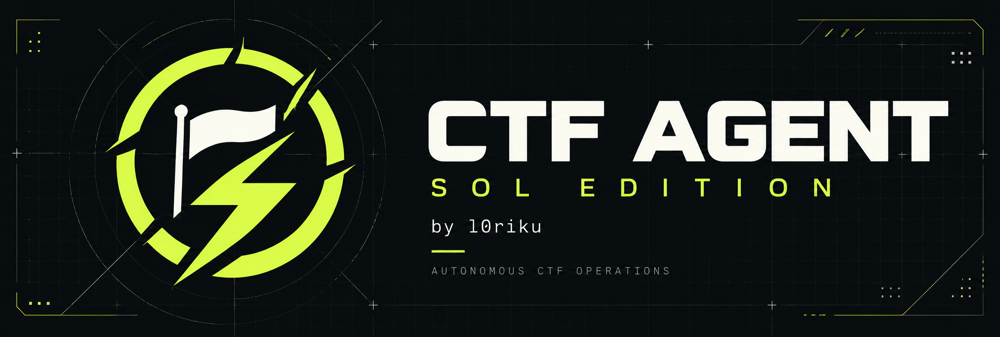
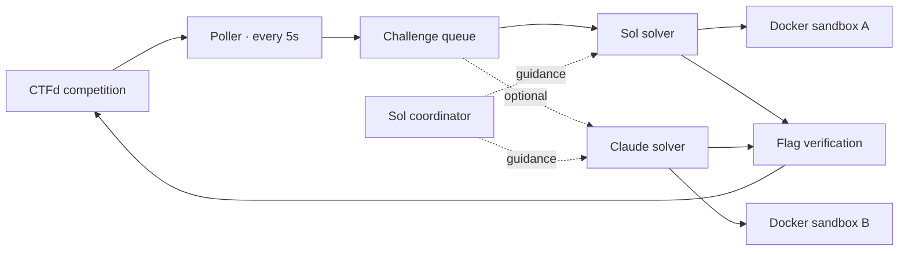

<div align="center">



### Read the challenge. Run the tools. Chase the flag.

**GPT-5.6 Sol at the controls. Docker sandboxes on the ground.**<br>An autonomous CTFd toolkit, tuned for competition workflows.

[](pyproject.toml) [](backend/models.py) [](#choose-your-lineup) [](LICENSE)

[Quick start](#launch-sequence) · [Models](#choose-your-lineup) · [How it works](#inside-the-loop) · [Commands](#operator-console)

**Sol edition by [l0riku](https://github.com/L0rikKelmendi)**<br>Built on [Veria Labs' CTF Agent](https://github.com/verialabs/ctf-agent).

</div>

---

## Built for the chase

Connect to a CTFd competition, load the available challenges, and let the agents work. GPT-5.6 Sol handles coordination and solving at **medium reasoning effort**. Add Claude Opus 4.8 when you want a second model racing for the same flag.

| Capability | What you get |
| :--- | :--- |
| **Automatic challenge queue** | Polls CTFd every five seconds and fills available solver slots. |
| **Sol as the brain** | A coordinator that reads traces, shares findings, and sends targeted guidance. |
| **One sandbox per solver** | Docker environments with binary analysis, crypto, web, and forensics tools. |
| **Optional model racing** | Sol and Claude can work on the same challenge concurrently. |
| **CTFd flag verification** | Candidate flags go through the competition API; incorrect guesses are deduplicated. |
| **Operator visibility** | JSONL traces, cost summaries, and hints you can send while agents run. |

> **Platform:** CTFd API integration. Use the competition site in your browser to get your token and follow results; the runner communicates directly with the API.

## Launch sequence

You need **Git**, **[uv](https://docs.astral.sh/uv/getting-started/installation/)**, a working **[Docker Engine](https://docs.docker.com/engine/install/)**, an **OpenAI API key**, and a **CTFd access token**. The sandbox expects a Linux Docker host with `/dev/loop-control` available. Python 3.14 can be installed by uv. The default API path needs no Codex or Claude CLI.

### 01 / Get the Sol edition

```bash
git clone --branch sol-edition https://github.com/L0rikKelmendi/ctf-agent.git
cd ctf-agent
uv python install 3.14
uv sync --locked
```

### 02 / Build the sandbox

```bash
docker build -f sandbox/Dockerfile.sandbox -t ctf-sandbox .
```

This is a substantial tooling image. Build it once per machine and reuse it across runs. Check that `docker info` works from the same user account that will run the agent.

### 03 / Add credentials

```bash
test -f .env || cp .env.example .env
nano .env
```

```dotenv
CTFD_URL=https://your-ctf-site.com
CTFD_TOKEN=your_ctfd_access_token
OPENAI_API_KEY=your_openai_api_key

# Optional: used only when you enable the Claude solver.
ANTHROPIC_API_KEY=
```

Use the site's **base URL** for `CTFD_URL`. In the CTFd browser, open **Settings → Access Tokens**, generate a token for your competition account, and paste it into `.env`. The runner loads this file automatically from the current directory. `.env` is excluded from Git.

### 04 / Check, then launch

```bash
# Local checks: configured keys, Docker access, and the sandbox image.
uv run ctf-solve --check

# Practice run: solve without submitting flags.
uv run ctf-solve --max-challenges 1 --no-submit -v
```

Stop the practice run with **Ctrl+C**, then start a live run when you want submissions enabled:

```bash
uv run ctf-solve --max-challenges 1 -v
```

**Live mode submits candidate flags automatically.** Keep the process running throughout the competition. The local check does not verify remote token validity or model access.

## Choose your lineup

| Role | Model | Access | Default |
| :--- | :--- | :--- | :--- |
| Coordinator | GPT-5.6 Sol · medium | OpenAI Responses API | Always on with the API coordinator |
| Solver | GPT-5.6 Sol · medium | OpenAI Responses API | Enabled |
| Extra solver | Claude Opus 4.8 | Anthropic Messages API | Opt in |

**Add Claude to the race** after setting `ANTHROPIC_API_KEY`:

```bash
uv run ctf-solve \
  --models openai/gpt-5.6-sol/medium \
  --models anthropic/claude-opus-4-8 \
  --max-challenges 1 -v
```

**Increase throughput** when your machine and API capacity can support more work:

```bash
uv run ctf-solve --max-challenges 3 -v
```

The challenge limit applies to challenges, not models: three challenges with two solver models can create six solver containers. More parallel work increases API usage and resource demand. The default remains one challenge with one Sol solver.

## Inside the loop



The scheduler starts solvers before waiting for the coordinator's first response. Challenges with more solves take priority; lower point values break ties. Coordinator turns run in the background, with pending events batched into serial turns, so a slow response does not block the scheduler.

Challenge IDs learned during polling are reused. Starting one challenge fetches that challenge's details; full detail fetches use at most four concurrent requests. Concurrent start requests respect the challenge limit. Stopped swarms cancel and join their solver tasks, and temporary submission errors do not blacklist a candidate flag as incorrect.

## Operator console

**Solve a local challenge folder** containing `metadata.yml` and optional `distfiles/`:

```bash
uv run ctf-solve --challenge challenges/CHALLENGE-SLUG --no-submit -v
```

**Use a predictable hint port:**

```bash
uv run ctf-solve --msg-port 9400 -v
```

Then, from a second terminal in the repo:

```bash
uv run ctf-msg --port 9400 "Check the PNG metadata before trying LSB extraction."
```

**Watch the trace files** generated in `logs/`, or inspect all CLI options:

```bash
uv run ctf-solve --help
uv run ctf-msg --help
```

<details>
<summary><strong>Download challenges ahead of time</strong></summary>

The coordinator downloads challenges as needed. To pull them manually instead:

```bash
uv run python pull_challenges.py \
  --url https://your-ctf-site.com \
  --token YOUR_CTFD_TOKEN \
  --output challenges
```

The output contains a folder per challenge, with `metadata.yml` and attached files under `distfiles/`.

</details>

<details>
<summary><strong>Legacy backends</strong></summary>

The original `--coordinator codex`, `--coordinator claude`, `codex/*`, and `claude-sdk/*` routes remain available. These require their corresponding command-line tools. Model routing is configured in [`backend/models.py`](backend/models.py); the default route uses the OpenAI API directly.

</details>

<details>
<summary><strong>Development and verification</strong></summary>

```bash
uv sync --locked
uv run pytest -q
uv run ruff check backend tests
```

The offline regression suite covers targeted HTTP fetching, bounded concurrency, challenge queuing, coordinator batching, cancellation, and submission retries. It does not require Docker or make paid model API calls. Passing offline tests does not establish live solve performance.

</details>

## Know your run

OpenAI and optional Anthropic API usage are billed by their providers. Both the coordinator and solvers can run for a long time; watch cost summaries and use **Ctrl+C** to stop. The runner does not currently enforce a spending cap or guarantee that every challenge will be solved.

The local paths `.env`, `.venv/`, `challenges*/`, and `logs/` are excluded from Git. Commit source changes and `uv.lock`; keep credentials and competition data on your own machine.

## Credits

**Sol edition, branding, and runtime updates by [l0riku](https://github.com/L0rikKelmendi).**

The original CTF Agent was created by [Veria Labs](https://verialabs.com). The CTFd interaction and HTML helpers in `pull_challenges.py` are based on [es3n1n/Eruditus](https://github.com/es3n1n/Eruditus). The original copyright notice is retained in the [MIT license](LICENSE).

---

<div align="center">

**CTF AGENT / SOL EDITION**<br><sub>by l0riku · built to keep the investigation moving</sub>

</div>
